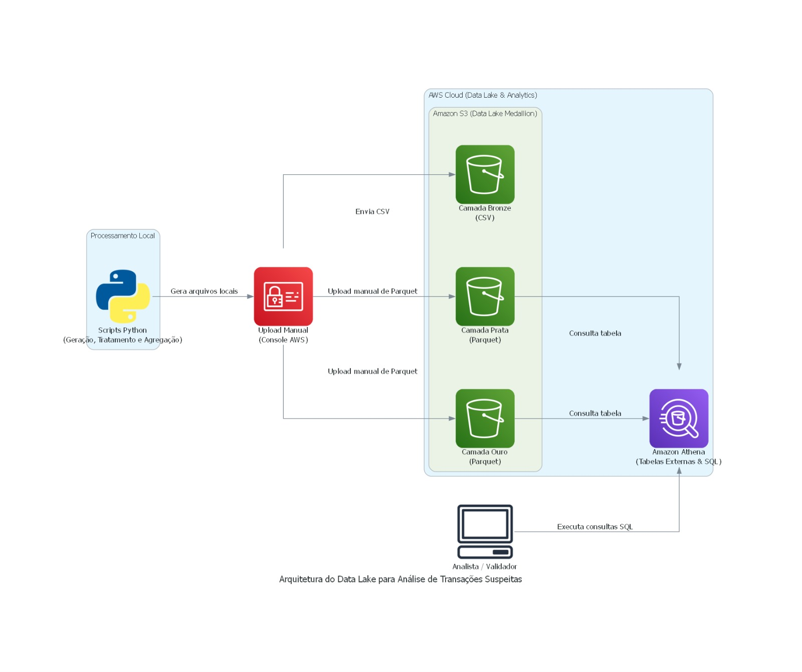

# Data Lake Antifraude Bancário | AWS

Projeto de construção de um Data Lake para simular o armazenamento e o processamento de transações bancárias, com foco na organização dos dados e na identificação de possíveis movimentações suspeitas.

A proposta é aplicar conceitos de Engenharia de Dados em um cenário bancário, utilizando a arquitetura Medallion (Bronze, Prata e Ouro), Python e serviços da AWS.

> **Status:** Em desenvolvimento. As camadas Bronze, Prata e Ouro já foram implementadas, e os dados estão disponíveis para consultas no Amazon Athena. A integração com o Power BI para construção do dashboard ainda está pendente.

## Objetivo do projeto

Desenvolver uma estrutura de armazenamento e processamento de dados que permita organizar transações bancárias em diferentes etapas, desde os dados brutos até informações agregadas que possam apoiar análises de fraude.

O projeto utiliza dados sintéticos, gerados com Python, para simular um cenário de movimentações financeiras.

## Arquitetura

A solução utiliza a arquitetura Medallion, dividida em três camadas:



### Camada Bronze

Armazena os dados brutos das transações bancárias em formato CSV, preservando os registros gerados inicialmente.

- Arquivo: `transacoes_bancarias_raw.csv`
- Formato: CSV
- Armazenamento: Amazon S3

### Camada Prata

Recebe os dados da camada Bronze, passando por etapas de tratamento e padronização.

- Conversão da coluna de data e hora.
- Criação da coluna `ano_mes`.
- Armazenamento em formato Parquet.

Arquivo: `transacoes_silver.parquet`

### Camada Ouro

Contém dados agregados por canal e tipo de transação, preparados para análises posteriores.

As métricas geradas são:

- `total_transacoes`: quantidade de transações.
- `total_valor`: soma dos valores transacionados.
- `ticket_medio`: média dos valores das transações.
- `volume_suspeito_fraude`: quantidade de transações sinalizadas como suspeitas.

Arquivo: `resumo_fraude_gold.parquet`

## Tecnologias utilizadas

| Tecnologia | Aplicação |
|---|---|
| Python | Geração e processamento dos dados |
| Pandas | Tratamento e agregação |
| NumPy | Geração de dados sintéticos |
| PyArrow | Leitura e gravação de arquivos Parquet |
| Amazon S3 | Armazenamento das camadas |
| AWS Glue Data Catalog | Catálogo das tabelas |
| Amazon Athena | Consultas SQL nos dados armazenados |

## Estrutura do projeto

```text
data-lake-antifraude-aws/
│
├── scripts/
│   ├── dados.py
│   └── dados_tratados.py
│
├── testes/
│   ├── validar_camadas.py
│   └── validar_agregacoes.py
│
├── consultas_sql/
│   ├── create_table_prata.sql
│   └── create_table_ouro.sql
│
├── dados/
│   ├── bronze/
│   ├── prata/
│   └── ouro/
│
├── documentacao/
│   ├── arquitetura/
│   │   └── arquitetura_data_lake.png
│   └── evidencias/
│       ├── 01_estrutura_tabela_prata.png
│       ├── 02_estrutura_tabela_ouro.png
│       ├── 03_dados_camada_prata.png
│       ├── 04_dados_camada_ouro.png
│       └── 05_estrutura_bucket_s3.png
│
├── requirements.txt
├── .gitignore
└── README.md
```

## Execução do projeto

### 1. Instalação das dependências

```bash
pip install -r requirements.txt
```

### 2. Geração dos dados sintéticos

```bash
python scripts/dados.py
```

O script gera 10.000 registros de transações bancárias e salva o arquivo CSV na camada Bronze.

### 3. Transformação dos dados

```bash
python scripts/dados_tratados.py
```

O script realiza o tratamento dos dados da Bronze, gera o arquivo Parquet da Prata e produz as agregações da camada Ouro.

### 4. Armazenamento na AWS

Os arquivos gerados localmente são enviados manualmente para seus respectivos diretórios no Amazon S3.

As tabelas externas das camadas Prata e Ouro são disponibilizadas no AWS Glue Data Catalog para consulta pelo Amazon Athena.

## Validação dos dados

Foram desenvolvidos scripts em Python para verificar a consistência dos arquivos gerados e validar as agregações.

Entre as verificações realizadas:

- Quantidade de registros por camada.
- Tipos de dados e estrutura dos arquivos.
- Quantidade de grupos gerados na camada Ouro.
- Consistência das contagens de transações.
- Validação dos valores totais e tickets médios.
- Conferência da quantidade de transações sinalizadas como suspeitas.

Os resultados confirmaram a consistência das agregações entre as camadas Prata e Ouro.

## Consultas com Amazon Athena

O Amazon Athena é utilizado para consultar os arquivos Parquet armazenados no S3 por meio de SQL.

Tabelas disponíveis:

- `tbl_transacoes_prata`
- `tbl_resumo_fraude_ouro`

As consultas permitem explorar as transações tratadas e analisar os indicadores agregados por canal e tipo de operação.

## Evidências da implementação

As capturas de tela da estrutura do bucket, tabelas do Athena, esquemas e consultas estão disponíveis em:

`documentacao/evidencias/`

## Próximas etapas

- [x] Geração de dados bancários sintéticos.
- [x] Implementação da camada Bronze.
- [x] Tratamento e implementação da camada Prata.
- [x] Agregações e implementação da camada Ouro.
- [x] Armazenamento das camadas no Amazon S3.
- [x] Criação das tabelas externas no Athena.
- [x] Consultas SQL e validação dos dados.
- [ ] Integração dos dados com Power BI.
- [ ] Desenvolvimento de dashboard para análise das transações e indicadores de suspeita de fraude.

---

**Projeto desenvolvido para fins educacionais e de portfólio, utilizando dados sintéticos.**
